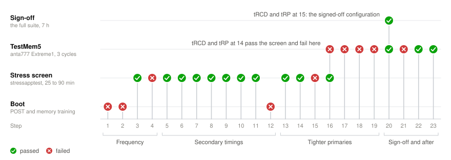
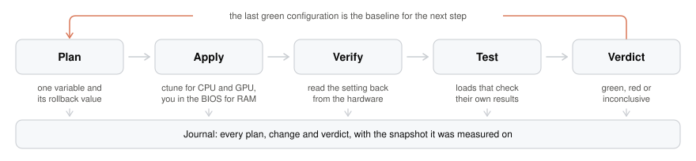
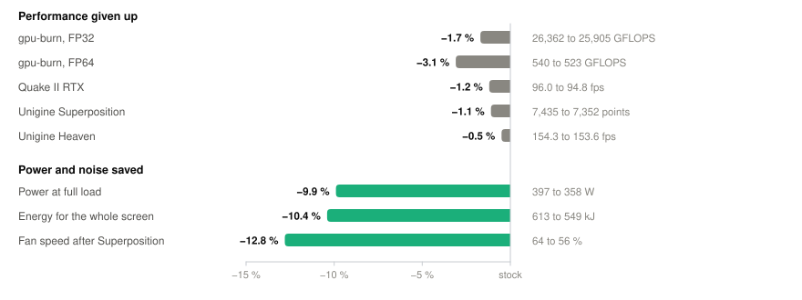
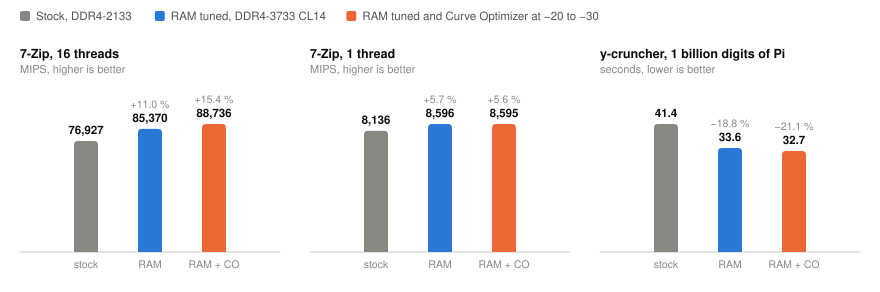
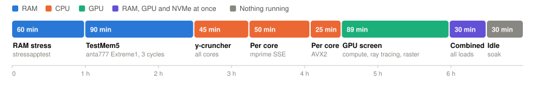

<h1 align="center">
  <picture>
    <source media="(prefers-color-scheme: dark)" srcset="docs/brand/lockup-animated-light.svg">
    <source media="(prefers-color-scheme: light)" srcset="docs/brand/lockup-animated-dark.svg">
    
  </picture>
</h1>

<p align="center">
  An agent tunes your RAM, CPU and GPU one change at a time, and a stress test judges every change.<br>
  For AMD Ryzen and NVIDIA on Linux.
</p>

ctune gives a coding agent the tools to overclock and undervolt a PC the careful way. The agent plans one change. ctune applies it or checks that you applied it, runs loads that verify their own results, and records the verdict in a journal. What comes out is the tuning a patient enthusiast does by hand over a few weekends, with a record of every step and the evidence behind it.

ctune writes little test code of its own. Prime95, stressapptest, TestMem5, y-cruncher, gpu-burn and memtest_vulkan do the testing. ctune drives them, watches the hardware error counters while they run, and reads their verdicts.

<p align="center">
  <picture>
    <source media="(prefers-color-scheme: dark)" srcset="docs/figures/campaign-on-dark.svg">
    
  </picture>
</p>

<p align="center"><sub>A DDR4 campaign on the reference machine: 23 steps, one variable each. Deeper tests catch what shallow ones pass. tRCD and tRP at 14 passed three 25 minute screens, then failed TestMem5 four times.</sub></p>

## How it works

A campaign tunes one domain (RAM, CPU or GPU) through a chain of steps. A step changes one variable, or one group of variables that only make sense together.

<p align="center">
  <picture>
    <source media="(prefers-color-scheme: dark)" srcset="docs/figures/loop-on-dark.svg">
    
  </picture>
</p>

- **Green** means no crash, zero corrected machine-check errors 300 s after the test, no error from any load, no NVIDIA Xid, and a score within about 1 % of the baseline. The configuration becomes the new baseline.
- **Red** is anything else. The agent rolls back to the baseline and records the limit it found.
- **Inconclusive** means the test could not judge, for example because another program held the VRAM. The agent fixes the cause and runs the test again.

Every test writes a crash marker first, so a freeze or a reboot in the middle of a test is recorded as red at the next boot. Commands print JSON, which is what the agent reads:

```console
$ bin/ctune errors
{
 "banks_monitored": 25,
 "total_corrected_errors_since_boot": 0,
 "nonzero_banks": {},
 "by_subsystem": {},
 "poll_interval_s": 300,
 "uptime_s": 334.06,
 "kernel_log": [],
 "note": "The kernel polls corrected errors every poll_interval_s; wait that long after a test before reading."
}
```

## What it tunes

| Domain | What changes | Who applies it | The test for one step | How long it lasts |
|---|---|---|---|---|
| **RAM** | Timings, FCLK, voltages, termination | You, in the BIOS. ctune never writes memory settings. It takes a snapshot and diffs it against the last one. | stressapptest over the free RAM while the GPU heats the case (25 min), then TestMem5 with the anta777 Extreme1 profile | Saved in the BIOS |
| **CPU** | The Curve Optimizer margin of one core | ctune, at runtime, through the SMU mailbox | Prime95 pinned to one core at a time, the way CoreCycler runs it, with the load paused for 1 s in every 10 | Until reboot. The final margins go in the BIOS. |
| **GPU** | Core and memory clock offsets, a locked maximum clock (the undervolt), the power limit | ctune, at runtime, through NVML | gpu-burn with checked results, Quake II RTX, Unigine Superposition and Heaven, memtest_vulkan (44 min) | Until reboot. A signed-off setting can be re-applied at every boot. |

A RAM snapshot is more than the timings. It holds the per-channel registers of the memory controller, the SMU clocks and voltages, and every BIOS setup option decoded by menu path from the EFI variables. `ctune mem compare` shows exactly what a trip through the BIOS changed.

## Results on the reference machine

A Ryzen 7 5800X3D on a Gigabyte B550 AORUS PRO with 4 × 8 GB of Samsung B-die and an RTX 3080 Ti, running Bazzite.

**The GPU undervolt** holds the card to 360 W and 1905 MHz with a +70 MHz core offset. Against the stock 400 W, on the same GPU screen:

<p align="center">
  <picture>
    <source media="(prefers-color-scheme: dark)" srcset="docs/figures/gpu-on-dark.svg">
    
  </picture>
</p>

**The RAM and CPU tuning** moves the kit from DDR4-2133 to DDR4-3733 CL14, then adds per-core Curve Optimizer margins of -20 to -30:

<p align="center">
  <picture>
    <source media="(prefers-color-scheme: dark)" srcset="docs/figures/bench-on-dark.svg">
    
  </picture>
</p>

## Getting started

ctune needs Python 3 and nothing from PyPI. It also needs the `ryzen_smu` kernel module, the NVIDIA proprietary driver, podman and polkit. TestMem5 runs through umu-run with xdotool, and Quake II RTX runs inside gamescope. Bazzite ships all three.

```bash
git clone https://github.com/josemanosalvas/ctune && cd ctune
bin/ctune status          # memory, CPU and GPU status, sensors, error counters, journal tail
bin/ctune passwordless    # optional: one prompt, then the root helpers run unattended
```

The test tools live in `tools/`, which git ignores. ctune installs most of them itself, with pinned hashes or commits:

| Tool | What ctune uses it for | Install |
|---|---|---|
| [stressapptest](https://github.com/stressapptest/stressapptest) | RAM screen, fabric test, combined load | Build into `tools/stressapptest/` |
| [TestMem5](https://testmem.tz.ru) with anta777 Extreme1 | The deep RAM test, under Proton | `ctune mem tm5-setup` |
| [y-cruncher](http://www.numberworld.org/y-cruncher/) | All-core stress in the sign-off | Static Linux release |
| [mprime](https://www.mersenne.org/download/) (Prime95) | Per-core Curve Optimizer test | Download from mersenne.org |
| [gpu-burn](https://github.com/wilicc/gpu-burn) | GPU compute with checked results | `ctune gpu burn-setup` |
| [Quake II RTX](https://github.com/NVIDIA/Q2RTX) | Ray-tracing load | `ctune gpu q2rtx-setup` |
| [Unigine](https://benchmark.unigine.com) Superposition and Heaven | Raster and tessellation loads | `ctune gpu unigine-setup` |
| [memtest_vulkan](https://github.com/GpuZelenograd/memtest_vulkan) | VRAM test, and the heat load in RAM tests | GitHub release |
| [nvidia_oc](https://github.com/Dreaming-Codes/nvidia_oc) | Re-applies signed-off GPU settings at boot | `ctune gpu persist-setup` |

TestMem5, mprime and the Unigine benchmarks do not allow redistribution, so never commit them. [docs/research/reuse-tools.md](docs/research/reuse-tools.md) and [docs/research/gpu-graphics-loads.md](docs/research/gpu-graphics-loads.md) explain each choice.

### With an agent

Open the repository in Claude Code. `.mcp.json` registers the ctune MCP server, which exposes the same commands as tools, and three skills run the campaigns:

- `ctune-mem` for memory timings, FCLK and voltages
- `ctune-cpu` for the Curve Optimizer
- `ctune-gpu` for the undervolt, the offsets and the power limit

The skills share one frame, [.claude/ctune/campaign.md](.claude/ctune/campaign.md), which defines the journal, the verdicts and what to do after a crash. The agent keeps what it learns about your machine in `data/this-machine.md`. To use the server from another project, run `claude mcp add ctune -- python3 -I <repo>/ctune/mcp_server.py`.

### By hand

```bash
bin/ctune mem snapshot --label X      # timings, clocks, voltages and every BIOS setting
bin/ctune mem compare                 # what changed since the previous snapshot
bin/ctune mem test                    # 25 min RAM screen
bin/ctune mem test tm5 --detach       # TestMem5, 3 cycles, in the background

bin/ctune cpu probe                   # read every core's margin back through the SMU
bin/ctune cpu apply --core 0 --margin -25 --dry-run
bin/ctune cpu test --cores 0          # Prime95 on core 0, about 6 min

bin/ctune gpu apply --max-clock 1860 --core-offset 150
bin/ctune gpu test screen             # the full GPU screen
bin/ctune gpu persist --dry-run       # after a green sign-off: keep the settings across reboots

bin/ctune signoff --detach            # the suite that ends a campaign
bin/ctune test-status                 # the running test and its phase, or the last result
bin/ctune test-stop
```

`bin/ctune <command> --help` lists the rest.

## The sign-off

A campaign ends with a sign-off of its final configuration: every domain alone, then all of them at once, then nothing at all, because an unstable Curve Optimizer or memory fabric often fails at idle.

<p align="center">
  <picture>
    <source media="(prefers-color-scheme: dark)" srcset="docs/figures/signoff-on-dark.svg">
    
  </picture>
</p>

Long tests run detached as systemd user units, so they outlive the agent's session and hold a sleep lock. Each finished phase goes to the journal, so a stop or a crash keeps the phases already done. After a green sign-off comes the last test: a few days of your real workload.

## Guardrails

Tuning at the edge of stability can crash the machine, and unstable RAM can corrupt files. ctune is built to keep each step small and reversible:

- **RAM settings are read, never written.** You make every BIOS change, and a snapshot proves what changed.
- **CPU and GPU changes clear on reboot.** A crash puts the machine back on its BIOS values.
- **The Curve Optimizer needs a clean probe.** Before the first write in a boot, ctune must read the BIOS margins back from every core. Margins stay within -30 to +30 and move at most 5 counts at a time.
- **GPU values are checked twice.** A root helper holds each one inside the range NVML reports and inside ctune's own caps.
- **Persistence needs a sign-off.** Only GPU settings that passed a green sign-off can be re-applied at boot.
- **One test at a time,** and a test refuses to start when it cannot judge, for example with too little free VRAM.

## Hardware support

| | Supported | Tested on |
|---|---|---|
| CPU | AMD Zen 3 on AM4 | Ryzen 7 5800X3D |
| Memory | DDR4 | 4 × 8 GB Samsung B-die |
| Board | Any Zen 3 board for timings and SMU values. The BIOS decoder covers the Gigabyte B550 AORUS PRO. | B550 AORUS PRO rev 1.0 |
| GPU | NVIDIA through NVML | RTX 3080 Ti |
| OS | Linux with systemd | Bazzite |

Other boards need their own decoder keys for the BIOS menus. ctune detects Zen 4 and Zen 5 but has no collectors for them yet. Each CPU platform is its own package under `ctune/mem/platforms/`.

## Repository

- `ctune/core/`: the journal, machine-check counters, sensors, the test runner and the sign-off suite
- `ctune/mem/`, `ctune/cpu/`, `ctune/gpu/`: one package per domain, each with its guarded root helper
- `ctune/mcp_server.py`: the MCP server, standard library only
- `.claude/`: the skills and the campaign frame
- `docs/`: [design notes](docs/design.md) and [research notes](docs/research/) with their sources
- `tests/`: offline tests, `python3 -B -m unittest discover -s tests`
- `data/` (ignored, or `$CTUNE_DATA`): snapshots, the journal and `this-machine.md`

`python3 docs/figures/build.py` redraws the figures on this page, and `python3 docs/brand/build.py` the logo.

## Roadmap

1. An unattended loop: a runner that starts after a boot or an apply, runs the test, writes the journal and wakes the agent.
2. Gigabyte profile files that load with "Load Profile", so a RAM step no longer means typing in the BIOS.
3. A platform-neutral snapshot format, then Zen 4 on AM5 with DDR5.

## Name

ctune is named after C'Thun, and its mascot crosses C'Thun with Clawd, the Claude Code mascot.

## License

MIT, see [LICENSE](LICENSE).
